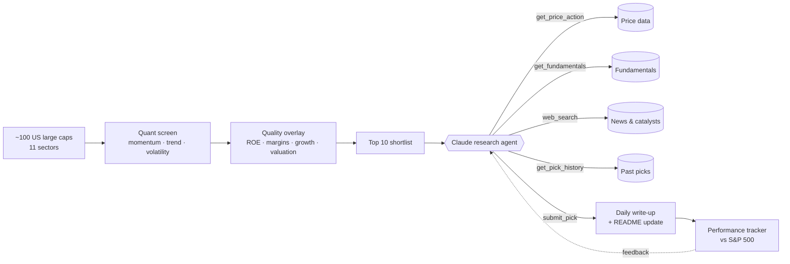

<div align="center">

# 📈 Pickwise

**An autonomous AI research agent that publishes one well-reasoned stock idea every trading day and keeps score of itself.**

[](https://github.com/vijayrkn/pickwise/actions/workflows/ci.yml)
[](https://github.com/vijayrkn/pickwise/actions/workflows/daily-pick.yml)


</div>

> [!WARNING]
> **Not financial advice.** Pickwise is an educational project in agent design. Picks are generated automatically, may be wrong, and ignore your personal situation.

## Today's pick

<!-- today:start -->
_The first pick will appear here after the next scheduled run._
<!-- today:end -->

## Track record

Every pick is logged with its entry price and scored against the S&P 500 (SPY) over the same window. Nothing gets deleted, so the misses stay on the record too.

<!-- track-record:start -->
_Track record starts after the first pick._
<!-- track-record:end -->

Full history: [`picks/`](picks/)

---

## How it works

Pickwise splits the job between deterministic code and the LLM, giving each the part it's best at:



1. **Screen (code).** Pulls a year of prices for the universe in one batch call and computes 12-1 month momentum, 3-month return, trend (50/200-day averages), volatility, distance from the 52-week high, and RSI. The top 25 then get a quality score from fundamentals and are re-ranked to a 10-name shortlist. Anything picked in the last 30 days is excluded.
2. **Research (agent).** Claude Opus 5.5 gets the shortlist and a toolset. It decides which names deserve a closer look, pulls price action and fundamentals, searches the web for recent earnings and catalysts, and checks its own track record before committing.
3. **Decide (structured output).** The agent must call `submit_pick` with a strict JSON schema (thesis, catalysts, risks, conviction, and why it beat the runner-up). Off-shortlist tickers are rejected, and the agent is told to try again.
4. **Publish and track (code).** A GitHub Action runs every weekday before the US open. It writes `picks/YYYY-MM-DD.md`, appends to `picks/history.json`, refreshes this README, and commits.

### Design choices

| Decision | Why |
|---|---|
| The quant screen runs *before* the LLM | Cheap, reproducible and testable. The model spends its effort on judgment, not arithmetic. |
| Strict tool schemas plus a terminal `submit_pick` tool | Output is guaranteed to parse. Validation errors go back to the model as `is_error` tool results so it can self-correct. |
| Server-side web search | Fresh news without running a scraper. Results come with citations, which end up in `sources`. |
| The agent sees its own track record | Discourages repetition and overconfidence. "Low conviction" is an allowed answer. |
| `fallbacks: "default"` on every request | If the primary model declines, the API retries on a fallback model inside the same call, so the daily job doesn't fail silently. |
| `--no-llm` quant-only mode | The pipeline still runs (and CI can exercise it) without an API key. |

## Quick start

```bash
git clone https://github.com/vijayrkn/pickwise && cd pickwise
python -m venv .venv && source .venv/bin/activate
pip install -e ".[dev]"

pickwise screen                 # today's quantitative shortlist
pickwise run --no-llm --dry-run # quant-only pick, nothing written
export ANTHROPIC_API_KEY=sk-ant-...
pickwise -v run --dry-run       # full agent run, printed to the terminal
pickwise run                    # publish to picks/ and update README
pickwise track                  # performance of every past pick
```

### Run it on your own fork

1. Fork the repo.
2. Make sure web search is enabled for your organization in the [Claude Console](https://console.anthropic.com) settings. Without it the agent still runs, but on price and fundamentals only.
3. Add an `ANTHROPIC_API_KEY` secret under **Settings → Secrets and variables → Actions**.
4. Enable workflows on the **Actions** tab. The `Daily pick` workflow runs at 13:00 UTC on weekdays, and you can also trigger it by hand.

Without the secret, the workflow falls back to quant-only picks.

## Project layout

```
src/pickwise/
├── universe.py     # tickers by sector + benchmark
├── market_data.py  # yfinance wrapper (prices, fundamentals)
├── screener.py     # factor maths and composite ranking
├── tools.py        # tool schemas + implementations the agent can call
├── agent.py        # Claude tool-use loop, system prompt, quant-only fallback
├── report.py       # Markdown write-up and README sections
├── tracker.py      # pick history and performance vs SPY
└── cli.py          # `pickwise run | screen | track`
tests/              # offline tests with synthetic prices and a scripted fake Claude client
```

## Testing

```bash
pytest -q && ruff check src tests
```

The suite runs fully offline. Price series are synthetic with known shapes (steady uptrend, volatile, flat, downtrend), and the agent loop runs against a scripted fake client. The tests cover parallel tool results, rejection of off-shortlist picks, refusal handling, and nudging the agent when it stalls.

## Roadmap

- [ ] Sector-neutral mode (one pick per sector per week)
- [ ] Email and Slack delivery of the daily write-up
- [ ] Rolling equity curve chart in the README
- [ ] Earnings-calendar awareness to avoid picking the day before a report

## License

MIT © Vijay Ramakrishnan
